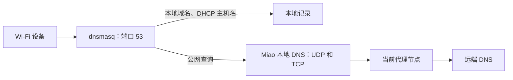

# OpenWrt DNS 修复设计与验收

[文档目录](README.md) · [故障证据](openwrt-review.md#2026-11-25wi-fi-的-google-首页失败确认-dns-接管缺口)

日期：2026-11-25。目标设备：树莓派 5、ImmortalWrt 25.12.2、dnsmasq 2.93、fw4，以及经 Tailscale 到达的代理节点。本页记录已实现的 DNS 接入、独立恢复和系统解析入口保护，以及验收要求。最终实机复核结果见本文末尾及 [整体复核记录](openwrt-review.md)。

## 推荐方案

将 DNS 接入 Miao 的启动、停止与异常恢复流程。保留 dnsmasq 作为 Wi-Fi 设备的 DNS/DHCP 入口，由它处理 DHCP 主机名、本地域名与本地反向查询，将全局模式的公网解析交给 Miao。



用户仍只需启动服务。程序负责识别当前 OpenWrt 环境、接入 DNS、清理旧缓存及失败恢复。

## 方案依据与已验证约束

| 项目 | 实际情况与设计影响 |
| --- | --- |
| 污染来源 | dnsmasq 从 `/tmp/resolv.conf.d/resolv.conf.auto` 读取上级 DNS `192.168.1.1`；该地址位于本地 WAN 子网，查询绕过当前透明接管 |
| 内置 DNS | Miao 经代理使用 TCP 查询 `1.1.1.1`，已能得到正常 Google 地址；可以复用这条已验证的路径 |
| DNS 重定向 | ImmortalWrt 的 `inet dnsmasq` 表将收到的 UDP/53 送给 dnsmasq；保留这个入口，由 dnsmasq 转发至 Miao |
| 动态接口 | 当前 dnsmasq 编译为 `no-DBus`，UBus 未提供设置上游的方法，不能假定可以直接调用 SetServers |
| 重读配置 | 独立实例实测：新增 conf-dir 片段后，HUP 不会加载它；需要受控重启对应实例。重启也会清除旧缓存 |
| 原上游竞争 | 独立实例实测：旧默认上游与追加的 `server=/#/...` 可以并存，查询仍能返回旧结果；必须确保公网查询只有受保护的有效上游 |
| 配置作用域 | 当前有效配置包含 `conf-dir=/tmp/dnsmasq.cfg01411c.d`，该目录已进入 dnsmasq 的 jail，可使用具有本实例标记的运行时片段 |
| PID | 生产 pid 文件写的是 jail 内 PID `1`；procd 报告宿主 PID `3248`。服务操作必须经 procd/实例管理接口，不能直接对该 PID 文件执行 kill |
| 系统解析 | `/etc/resolv.conf` 是 Tailscale 管理的普通文件，与 `/tmp/resolv.conf` 分开；方案不直接改写它，并验证 MagicDNS 和管理连接保持正常 |

实验只启动了三个绑定回环高端口的独立 dnsmasq 实例，用 `192.0.2.66`、`192.0.2.77` 模拟错误与正确答案。实验已结束，测试端口已关闭，生产 dnsmasq PID 未变。记录：`/tmp/miao-pi5-session/dns-design-probe-v2.json`。

## 启动与切换流程

1. **预检。** 从 procd/ubus 识别唯一活动 dnsmasq 实例、有效配置与 conf-dir；多实例和非标准服务结构明确拒绝。检查其已有全局上游、域名专用上游、DNSSEC、其他 DNS 代理和目录权限。固件或 Tailscale 在核心就绪期间重新生成配置时，完整复检一次，使用通过复检的最新系统解析器；实例身份、私有域接入方式发生变化，出现竞争上游或配置仍不稳定时拒绝启动。端口、规则或服务归属不明确时，在改变现有服务之前返回诊断。
2. **生成本地 DNS 入站。** 在 sing-box 增加仅监听回环地址、同时接收 UDP/TCP 的 DNS 入口，例如 `127.0.0.1:6263`。端口必须纳入 SOCKS、面板、Clash 和代理池的冲突检查。通过入站专用的 `hijack-dns` 规则交给内置 DNS 引擎，避免受普通 SOCKS 或进程名单规则误分流。固定核心 1.14.4 的这一配置形态已通过 `sing-box check`，实际收发仍须在实现后验收。
3. **区分两种解析用途。** 全局模式的公网 DNS 统一经当前代理节点解析；代理节点自身域名的引导解析使用独立路径，避免形成“解析节点需要先连接节点”的循环。当前 Tailscale 出站选路修复继续保留。本地域名和必要的 MagicDNS 转发规则需单独保留。
4. **先验证核心。** 启动核心，确认本地 DNS 的 UDP、TCP 请求及代理侧上游查询可用。此时尚未让 dnsmasq 指向它；失败时回滚本次核心资源。
5. **以事务方式接入。** 先写私有归属日志并启动独立恢复守护，再原子安装本实例的运行时配置片段。当前设备没有显式全局 `server=`，可以用下述片段排除 WAN resolv-file，并指定 Miao 为公网默认上游。已有显式全局上游或其他 DNS 接管器的设备必须另行适配，不能盲目叠加。
6. **使配置生效并清缓存。** 通过固件的服务管理机制受控重启对应 dnsmasq 实例，保留 DHCP 租约和接口状态。不能把“写文件后 HUP”当作安装成功。再从路由器及 LAN 查询，确认结果来自新解析路径。
7. **发布就绪状态。** 核心、TUN、DNS 入站和 dnsmasq 转发链均验证后，才将自动接管标为完成；错误必须附带回滚结果。

运行时片段示意，端口以实际规划为准：

```conf
# miao:<instance-token>，仅在代理激活期间存在
no-resolv
server=127.0.0.1#6263
```

`no-resolv` 只排除 resolv-file 中的服务器，不能删除其他配置里的 `server=`。因此上游冲突预检是启动条件。不能把 `192.168.1.1` 或其他未保护的服务器留作并行备选，否则仍可能先返回污染结果。

片段位于有效 conf-dir 中，以实例 token 和内容哈希确认归属。配置中只包含回环端口；节点凭据继续留在 Miao 的私有运行目录。文件权限应符合 dnsmasq 降权及 jail 的读取要求。

## Tailscale 系统 DNS 的补充保护

实机发现，dnsmasq 返回正确结果时，系统默认的 Tailscale DNS `100.100.100.100` 仍可能返回错误 Google A 和 `2001::1`。系统还配置了 IPv6 DNS `fd7a:115c:a1e0::53`。仅检查 dnsmasq，或仅修复 IPv4 DNS，不能完成路由器默认解析验收。

程序读取 `/etc/resolv.conf`，将其中非回环的系统解析器在运行期间接入 dnsmasq，覆盖 UDP/TCP 和 IPv4/IPv6 地址，不改写该文件。规则位于 Miao 专用 nft 表，只处理这些 DNS 地址的 53 端口；核心引导 DNS、MagicDNS 的直连请求和 Tailscale 自身带标记的基础连接保留独立路径。DNS 入口的 IPv6 传输不改变当前 IPv4 业务代理范围。

系统 DNS 规则先做语法与归属预检，通过原子批次创建；独立守护在停止或异常恢复时先撤销这些规则，再恢复 dnsmasq。表归属同时校验操作标记和内核句柄，按句柄删除，拒绝覆盖同名外部表。旧 nft 的 JSON 可能不包含表注释，因此使用可读取的规则注释确认归属。

实机还需要处理两个回包约束：dnsmasq 的 `local-service` 会忽略部分以 Tailscale 地址为来源的回环请求，Tailscale 的输入链也会拒绝从回环进入的这类源地址。Miao 在自有表中将重定向查询的来源转换为回环地址，保留 dnsmasq 的原访问限制；为 conntrack 已确认的 DNS 回复添加带本次操作标记的窄范围例外，并在 Tailscale 重建链后补齐。停止和异常恢复同时撤销这些例外。

私有 `*.ts.net` 查询由核心直接送往 MagicDNS，保留 A 与 ULA AAAA；仅为发现的私有域增加 dnsmasq 的重绑定豁免，公网域名继续保持重绑定保护。已有私有转发器若会被系统 DNS 重定向送回自身，预检拒绝该冲突，避免解析循环。

系统解析器已指向回环 dnsmasq 时，无需额外 nft DNS 规则。非回环系统 DNS 当前需要可用的 nft 工具与内核支持；能力不足时在改变现有服务前报告 `DNS_SYSTEM_RESOLVER_UNSUPPORTED` 或 `DNS_SYSTEM_RULES_FAILED`，不会静默保留未保护的默认解析路径。

## 停止与异常恢复

| 场景 | 必须满足的行为 |
| --- | --- |
| 正常停止、切换代理池 | 先撤销 DNS 片段，使 dnsmasq 恢复原上游并验证可用，再停止核心；成功后才保存“已停止” |
| 节点/订阅变更导致核心重启 | 预检新配置；协调 DNS 撤销、核心替换、DNS 重新接入，避免长时间指向没有监听者的端口 |
| DNS 恢复失败且旧核心仍活着 | 保留旧核心提供解析，报告恢复失败；状态必须准确表示仍在运行，允许重试停止 |
| 核心异常退出 | 管理器的退出监视任务立即恢复 DNS，并清理本次网络资源 |
| Miao 被 SIGKILL | 由独立、受 procd 监督的恢复守护撤销本实例片段并恢复 dnsmasq，确认核心退出后回收归属记录中的路由、nft 表与 fw3 规则；不能依赖被杀死进程中的析构函数或异步任务 |
| 下次启动 | 在订阅获取和节点域名解析前恢复遗留 DNS 状态，再准备新实例 |
| 整机重启 | 运行时片段随 `/tmp` 清除，原 UCI 与原动态 resolv-file 保留；Miao 自动启动时重新执行接入流程 |

恢复守护在 DNS 变更前就必须可用。日志应记录 boot ID、网络命名空间、管理器/核心 PID 与启动时间、操作代次、目标 dnsmasq 实例、片段路径和内容哈希。与管理器共享跨进程锁，防止两方同时重启服务；旧守护不能撤销新操作代次的设置。

恢复时只撤销本实例添加的内容，保留管理员并发修改，重新使用系统当前的 WAN DNS，避免恢复过期的 DNS 地址快照。清理失败保留记录并报告，不能删除日志后假装成功。现有诊断用的 20 秒停止脚本依赖面板 API，不适合作为生产 DNS 恢复守护。

上游节点临时不可达时应报告 DNS/节点连通性异常；不能在仍声称代理开启的状态下，静默并行使用未保护的旧 DNS。

## 实现位置

| 位置 | 修改内容 |
| --- | --- |
| `src/services/config.rs` | 本地 DNS 入站、入站专用 hijack 规则、全局公网解析策略与引导解析分离；迁移旧生成缓存 |
| `src/services/share_ports.rs` | DNS 入站端口预留及 TCP/UDP 冲突检查 |
| 新增 `src/services/openwrt_dns.rs` | 实例发现、原配置检查、归属日志、片段安装/撤销、服务操作与恢复 |
| `src/state.rs` | 保存本次 DNS 适配句柄及状态 |
| `src/services/singbox.rs` | DNS 就绪检查、启停顺序、核心退出后的恢复；停止失败时保留仍可用的核心 |
| `src/handlers/service.rs` 及其他启动入口 | 只有实际成功停止后保存运行状态；取消、回滚、CLI、缓存恢复和模式切换使用同一生命周期 |
| 内部恢复守护入口 | 在管理器死亡后独立恢复 DNS，通过 procd 使用正确的宿主进程身份 |
| `scripts/tests/openwrt_runtime_test.py` | 增加真实 dnsmasq、污染上游、旧缓存、崩溃及恢复场景 |

先完整修复当前全局模式。代理池不接管系统 DNS；进程模式需按 `dns_follow_process` 的现有语义单独设计和验收，不能把 dnsmasq 汇总的查询误认为原应用进程的查询。

## 验收要求

- 隔离环境先复现：未启用 Miao 时，dnsmasq 从模拟上游取得错误 Google 地址并缓存；启用后取得正确结果，即使旧缓存 TTL 为一小时。
- UDP/TCP 的本地 DNS 入站、路由器 DNS 与 LAN 查询都通过，且没有同时向旧默认上游查询。
- DHCP 主机名、本地域名、反向查询及明确保留的私有域名转发继续正常。
- 验证 `www.google.com`、实际跳转域名及搜索页面的真实 TLS/HTTPS。最终验收使用系统默认解析，不使用固定 IP、`--resolve` 或显式 SOCKS 绕过问题路径。
- 用实际 Wi-Fi 浏览器验证，并结合流量日志确认连接正确目标。首次修复后，终端可能仍缓存旧地址，可重连 Wi-Fi 或清理浏览器/系统缓存；路由器不能强制清除所有终端缓存。
- 验证异常 AAAA 被正确处理，并验证 Tailscale 管理连接、MagicDNS 及节点出口保持正常。
- 覆盖 DNS 端口占用、片段语法错误、dnsmasq 重启失败、启动取消和旧配置回滚。
- 分别 SIGKILL 核心、SIGKILL 管理器，确认 DNS 无需用户重启 Miao 也能恢复。
- 多轮启停、切换代理池、WAN DNS 更新及防火墙重载后仍无活动遗留设置。
- 部署前后比较用户配置、认证、节点、DHCP/Wi-Fi 和持久防火墙配置；整机重启验收另在可维护窗口安排。

部署时先备份当前可用程序与用户数据，保留管理通道，并在小范围验证恢复机制后启用 DNS 接管。页面继续只显示自动配置状态，详细诊断显示 DNS 接入与恢复结果，不新增需要用户选择的 DNS 模式。

## 本轮状态

已实现并部署：回环 TCP/UDP DNS 入站、dnsmasq 临时片段与旧缓存清理、系统 IPv4/IPv6 DNS 入口保护、MagicDNS 私有域转发，以及独立的 procd 恢复守护。配置校验、归属校验和恢复失败均保留明确错误；启动期间配置变化通过一次完整复检处理，无法安全采用时报告具体文件并回滚。DNS 已恢复但网络资源清理仍待重试时，记录恢复进度，避免反复重启 dnsmasq。

隔离环境已覆盖污染上游、长期缓存、DHCP 名称、端口及配置冲突、停止恢复失败、管理器和核心强制退出、WAN DNS 更新、Tailscale 过滤链重建与外部 nft 表替换。两套 fw3/fw4 验收均覆盖 39 个私有订阅节点的导入、重启和删除，私有内容不进入仓库。

树莓派已通过默认 DNS 的 Google 首页与搜索页面、百度、实际 LAN 网桥的 TCP/UDP DNS 和真实 HTTPS 验证；生命周期及最终资源复核结果以 [整体复核记录](openwrt-review.md) 的本轮条目为准。物理 Wi-Fi 浏览器的缓存仍由终端管理，网桥客户端验收不能替代每台物理终端；本轮不重启整机。
